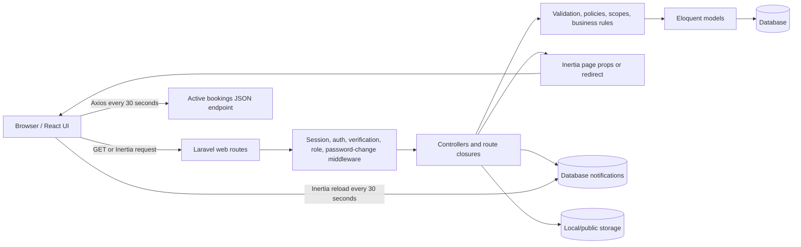

# ReserveIT Architecture

ReserveIT is a Laravel and React facility-reservation system for the University of the Immaculate Conception. It is a monolithic web application: Laravel owns routing, authentication, authorization, validation, business rules, persistence, and Inertia responses; React renders the user interface and submits requests through Inertia.

## Technology Stack

- **Backend:** PHP 8.2+, Laravel 12
- **Authentication:** Laravel session authentication with Breeze-style pages
- **Frontend:** React 18, Inertia.js 2, and Vite
- **UI:** Tailwind CSS, Lucide React, Framer Motion, and Sonner
- **HTTP:** Inertia router for page/form requests; Axios for the active-bookings JSON monitor
- **Database:** MySQL is the documented local target; migrations also support SQLite-style test development
- **Storage:** Local disk for consent letters; public disk for facility images
- **Queues:** Laravel database queue configuration; the development script starts a queue listener
- **Route generation:** Ziggy provides the frontend `route()` helper

## Key Entry Points

- [routes/web.php](../routes/web.php): application pages and business endpoints
- [routes/auth.php](../routes/auth.php): authentication, verification, password, and logout routes
- [bootstrap/app.php](../bootstrap/app.php): routing and middleware registration
- [resources/js/app.jsx](../resources/js/app.jsx): Inertia/React bootstrapping
- [vite.config.js](../vite.config.js): Vite and Laravel asset configuration
- [app/Http/Controllers](../app/Http/Controllers): backend handlers
- [resources/js/Pages](../resources/js/Pages): Inertia page components
- [database/migrations](../database/migrations): schema history

## System Design

The application has no separate public frontend API for most operations. The browser receives an initial Inertia page response, then subsequent navigation and mutations use Inertia requests over the same Laravel web routes.



## Request Lifecycle

1. Laravel receives a request through the web route group.
2. Session middleware identifies the current user.
3. `HandleInertiaRequests` shares `auth.user`, flash toast data, and up to ten unread notifications.
4. Role middleware and, where applicable, a policy authorize the action.
5. A controller or route closure validates input, queries Eloquent, applies business rules, and returns one of:
   - an Inertia page and props;
   - a redirect with validation errors or flash messages; or
   - JSON for the active-bookings monitor.
6. Inertia updates the React page without a full document navigation.
7. React renders returned props, errors, toast messages, and local state.

## Roles and Authorization

| Role | Capabilities |
|---|---|
| `user` | Browse facilities and schedules, create reservations, edit own pending reservations, cancel own pending/approved reservations, manage profile, and manage support tickets |
| `facility_admin` | Operate assigned facilities, review bookings, approve/decline, remove past unapproved requests, check in/out, monitor active bookings, edit assigned facilities, and reply to tickets |
| `super_admin` | Manage all facilities and bookings, users, assignments, settings, concerns, approvals, and monitoring |

Authorization is implemented in multiple layers:

- `EnsureUserHasRole` protects routes using `role:...` middleware.
- `BookingPolicy` allows super admins to act on all bookings and facility admins to act only on bookings in assigned facilities.
- `Booking::forUser()` and `Facility::forUser()` constrain query visibility using the same assignment rule.
- `auth` requires a logged-in session; `verified` protects the main application group.
- `ForcePasswordChange` redirects temporary-password accounts until the password is changed.

## Frontend Structure

`resources/js/app.jsx` initializes Inertia, resolves a server page name to `resources/js/Pages/**/*.jsx`, mounts React, and installs the Sonner toast provider.

### Layouts and shared components

- `GuestLayout`: authentication and guest-facing presentation.
- `AuthenticatedLayout`: sidebar, role-sensitive navigation, notifications, support-ticket form, and notification polling.
- `BookingModal`: shared reservation form used by facility and calendar experiences.
- `CalendarView`: facility/time schedule visualization.
- `GlobalPageLoader`: loading overlay driven by Inertia router events.

### Page groups

- Public/shared: `Welcome`, `Facilities`, `FacilityDetails`, `CalendarDashboard`, and error pages
- User: dashboard, `MyBookings`, tickets, and profile pages
- Facilitator: dashboard, booking review, and managed facilities
- Super admin: dashboard, bookings, facilities, users, concerns, settings, and active monitoring
- Authentication: login, registration, verification, password reset/confirmation, and forced password change

## Frontend-to-Backend Communication

### Inertia page visits

React uses `<Link>` or `router.get()`. Laravel executes the route and returns `Inertia::render('PageName', props)`. Inertia receives the page name and props, then swaps the React page without a full browser reload.

```text
CalendarDashboard date input
  -> router.get(route('schedule.index'), { date })
  -> GET /schedule
  -> route validates the date and queries facilities/bookings
  -> Inertia::render('CalendarDashboard', props)
  -> React re-renders CalendarView
```

### Form submissions

React uses `router.post`, `router.put`, `router.patch`, or `router.delete`. Inertia includes the session/CSRF context and serializes fields, including uploads. Laravel validates the request. Errors return to the page; successful mutations normally redirect back with flash data.

```text
BookingModal
  -> router.post('/bookings', formData)
  -> BookingController::store()
  -> validate, check conflicts, save, optionally broadcast
  -> redirect back with a toast
  -> Inertia refreshes page props
```

### Shared notifications

`HandleInertiaRequests::share()` provides the current user, flash toast data, and the latest ten unread database notifications. `AuthenticatedLayout` refreshes only the notifications prop every 30 seconds with `router.reload({ only: ['notifications'] })`. This is polling, not a persistent WebSocket notification channel.

### JSON monitoring

The active-bookings page uses Axios instead of an Inertia page response:

```text
Admin/ActiveBookings.jsx
  -> axios.get(route('admin.active-bookings'))
  -> GET /admin/active-bookings
  -> BookingCheckInOutController::activeBookings()
  -> JSON { activeBookings: [...] }
  -> React state update
```

### Route naming

New frontend calls should use named routes through Ziggy. Some older components use literal paths such as `/bookings`; update both sides when changing those endpoints.

## Route and Feature Map

| Area | Routes/pages | Behavior |
|---|---|---|
| Public landing | `GET /` | Latest facilities and today's schedule preview |
| Authentication | `/login`, `/register`, password/email routes | Session authentication, verification, reset, and logout |
| Dashboard redirect | `GET /dashboard` | Routes each role to the appropriate dashboard |
| Schedule | `GET /schedule` | Date-filtered facilities and active bookings |
| Facilities | `GET /facilities`, `GET /facility/{id}` | Browse details and availability |
| Bookings | `/bookings`, `/my-bookings` | Create, list, edit, and cancel reservations |
| Review | Admin/facilitator booking routes | Approve, decline, filter, and clean up requests |
| Operations | Check-in, check-out, active-bookings JSON | Track occupancy and overtime |
| Administration | `/admin/facilities`, `/admin/users`, `/admin/settings` | Manage facilities, accounts, assignments, and rules |
| Concerns | `/concerns`, `/my-tickets`, `/admin/concerns` | Submit, resolve, reply, and notify |
| Profile | `/profile` and password routes | Manage profile and password |
| Notifications | `/notifications/clear`, `/notifications/{id}/read` | Mark notifications read |
| Consent files | `GET /bookings/{booking}/consent` | Authorized download from local storage |
