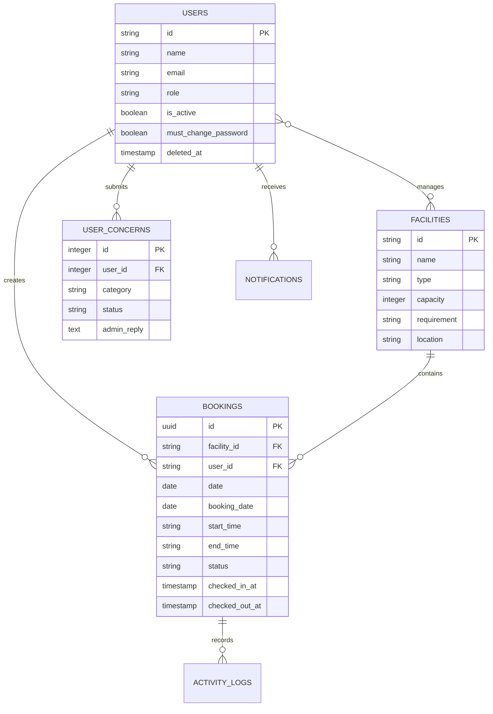

# ReserveIT Database

This document describes the persistent data model, relationships, migrations, and file-storage behavior used by ReserveIT.

## Database Conventions

- Facilities use string primary keys.
- Bookings use UUID primary keys and are represented as non-incrementing strings in `Booking`.
- Users use Laravel's standard primary key and `SoftDeletes`.
- Booking dates are represented by both `date` and `booking_date`; reporting generally uses `booking_date`, while operational display/check-in code also uses `date`.
- Eloquent casts dates, timestamps, booleans, and numeric values when models are read.

## Entity Relationship Overview

## Core Tables and Models

### `users` and `User`

Laravel's users table is extended with:

- `role`: `super_admin`, `facility_admin`, or `user`
- `must_change_password`: forces a temporary-password account through the password-change route
- `is_active`: account enable/disable state
- `deleted_at`: soft deletion while preserving related history
- standard name, email, password, verification, and session fields

Relationships:

- one user has many bookings;
- one user has many support concerns;
- facility admins belong to many facilities through `facility_user`;
- one user receives many database notifications.

### `facilities` and `Facility`

Facilities have string IDs and contain:

- name, type, capacity, description, image URL, requirement, and location;
- `requiresWeekendConsent`;
- `allowTdevsManpower`.

Relationships:

- one facility has many bookings;
- one facility belongs to many assigned facility admins.

The migration allows `Venue`, `Laboratory`, and `Equipment`, while the shared facility-management validation currently accepts `Venue` and `Laboratory`. Keep this contract aligned when changing facility types.

### `bookings` and `Booking`

Bookings contain:

- facility and optional user references;
- optional guest name, email, and phone fields;
- `date`, `booking_date`, `start_time`, and `end_time`;
- status: `pending`, `approved`, `declined`, or `cancelled`;
- notes, attendee count, and manpower request;
- consent-file metadata;
- approval and rejection metadata;
- check-in, check-out, and overtime timestamps.

The model defines relationships to `Facility` and `User`, UUID behavior, mass-assignable fields, and the `forUser()` scope that limits facility-admin visibility.

### `facility_user`

This pivot table assigns facility admins to facilities. It has a composite primary key of `facility_id` and `user_id`, timestamps, and cascading foreign keys.

### `activity_logs`

This table records booking actions and links each log to a booking. The current model/controller contracts should be normalized before relying on it as a complete audit trail.

### `user_concerns`

Support tickets contain:

- optional `user_id`;
- message, appeal date, category, and detailed information;
- `status`, defaulting to `pending`;
- optional `admin_reply`.

### `system_settings`

The inspected schema includes:

- `auto_approve_bookings`;
- `overtime_fee_per_hour`;
- `auto_purge_unapproved_days`.

The settings controller also accepts newer rule names such as `cleanup_buffer_minutes`, `max_advance_days`, `max_booking_duration`, `require_consent_letter`, and `auto_approve_scope`. These controller, model, and migration contracts must be aligned before those settings are treated as persistent configuration.

### `notifications`

Laravel database notifications contain a UUID, notification type, notifiable user, JSON/text data, `read_at`, and timestamps. ReserveIT uses this table for booking and support-ticket updates.

### Framework tables

The application also uses framework tables for jobs, failed jobs, cache, sessions, and migrations.

## Migration History

The schema is built incrementally through [database/migrations](../database/migrations). Significant changes include:

- base users, cache, and jobs tables;
- facilities and bookings;
- activity logs;
- user roles;
- forced password changes;
- active state and soft deletes;
- facility-admin assignment pivot;
- booking decline/rejection fields and normalized booking dates/statuses;
- support-ticket fields;
- system settings, check-in/out timestamps, overtime fields, and notifications;
- Google account identity, auto-purge configuration, and QR-verification cleanup.

Use `php artisan migrate:status` to inspect the applied migration set. Do not edit an already-applied migration in a shared environment; add a new migration for schema changes.

## Storage Models

### Consent documents

Consent files are accepted as PDF, DOC, or DOCX files up to 5 MB. They are stored on the private/local disk under `consent-letters`. Downloading requires authentication and authorization:

- super admins may download any consent file;
- facility admins may download files only for their assigned facilities;
- other users receive a forbidden response.

### Facility images

Facility images may be uploaded to the public disk under `facilities`, where the application stores a generated filename and derives a public URL. The facility form also accepts an externally supplied image URL.

## Data Integrity Notes

- Booking conflict checking is implemented in application code, not as a database exclusion constraint.
- Foreign keys cascade facility deletion to bookings and facility-admin assignments.
- User deletion is soft deletion, preserving booking history.
- Activity-log field names are currently inconsistent: the table/model use `performed_by`, while approval code attempts to write `user_id` and `notes`.
- The `Booking` model allows fields that must exist in the applied schema, so migrations and model fillable/cast definitions should be reviewed together.
