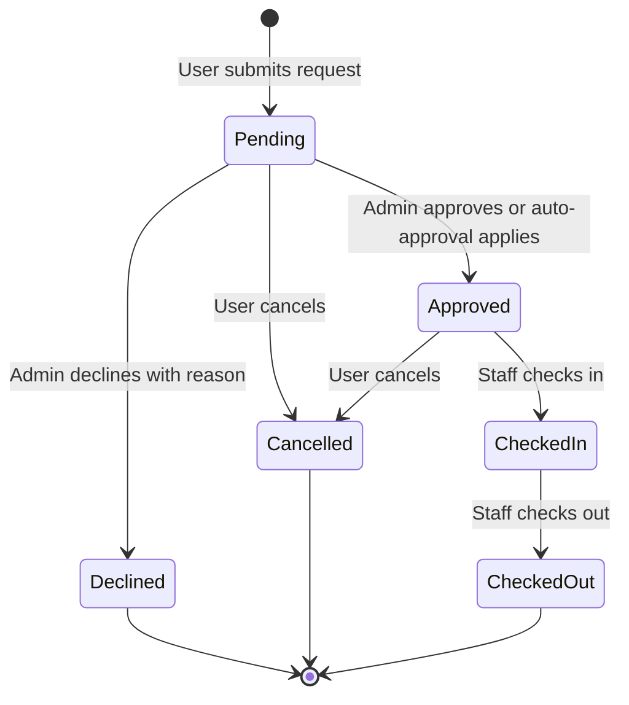

# ReserveIT Workflows

This document describes user-facing features, business rules, state transitions, and system processes.

## Booking Lifecycle

## Browse and Reserve a Facility

1. The landing page loads the six latest facilities and up to eight active bookings for today.
2. `/facilities` lists facilities.
3. `/facility/{id}` shows facility details, assigned administrators, and existing bookings.
4. `/schedule?date=YYYY-MM-DD` returns facilities and active bookings for the selected day.
5. `BookingModal` collects applicant details, event information, date/time, attendees, optional manpower, notes, and a consent document when required.
6. React sends an Inertia `POST /bookings`.
7. Laravel validates the request, re-checks business rules, and creates a pending or approved booking.
8. The user receives a success toast and the booking appears in the user's and administrators' views.

Anonymous booking is not currently end-to-end supported: the UI collects guest details, but the booking route is inside the authenticated/verified group and the controller always associates the booking with `Auth::id()`.

## Booking Rules

The server currently enforces:

- facility existence;
- required date, start time, and end time;
- end time later than start time;
- maximum advance date using `max_advance_days`, defaulting to 30;
- conflict checks against pending and approved bookings;
- a cleanup buffer before and after neighboring bookings, defaulting to 30 minutes;
- optional or required consent upload according to `require_consent_letter`;
- PDF, DOC, and DOCX consent files up to 5 MB.

The React form additionally checks:

- visible times between 08:00 and 20:00;
- facility capacity;
- blackout dates passed to the component;
- a three-day lead time for consent-required or weekend bookings;
- optional TDEVS manpower.

Client-side rules improve feedback but are not the security boundary. Rules that must never be bypassed should also be enforced in the controller.

## Auto-Approval

The booking controller evaluates the configured approval scope:

- `disabled`: new bookings remain pending;
- `everyone`: new bookings are approved automatically;
- `superadmin_only`: a booking from a super admin is approved automatically.

Automatically approved bookings receive `approved_at` and an explanatory `approved_by` value.

## Approval and Decline

- Pending requests appear in the admin/facilitator review pages.
- Facility admins see only bookings for assigned facilities.
- Approval records `status=approved`, `approved_at`, and `approved_by`.
- Decline requires a reason in the facilitator workflow and records rejection data.
- The requester receives a database notification for approval or decline.
- Past pending bookings are separated into a cleanup list.
- Authorized administrators can delete one or all visible past unapproved bookings.

There are duplicate approval surfaces in the current code. The facilitator approval controller includes booking-policy authorization and user notifications and should be treated as the canonical workflow until the direct booking endpoints are consolidated.

## User Booking Management

Users can:

- view their own bookings separated into upcoming and history;
- search by facility and filter by status;
- open booking details;
- edit only pending bookings;
- cancel pending or approved bookings.

Cancellation changes the status to `cancelled`; it does not delete the record. Editing validates the date, time range, attendees, manpower flag, and notes, but it does not currently repeat every creation-time rule such as conflict checking and advance-window enforcement.

## Check-In, Check-Out, and Overtime

1. A facility admin or super admin posts to `/bookings/{booking}/check-in`.
2. Only approved bookings may be checked in, and a duplicate check-in is rejected.
3. Staff posts to `/bookings/{booking}/check-out` after check-in; duplicate check-out is rejected.
4. `/admin/active-bookings` returns approved bookings that are checked in and not checked out.
5. The endpoint calculates overtime by comparing the current time with the scheduled end time.
6. Overtime fees are calculated as elapsed hours multiplied by `overtime_fee_per_hour`.
7. The React monitor polls every 30 seconds and highlights overtime records.

## Support Tickets and Concerns

- `POST /concerns` accepts a message, optional appeal date, category, and detailed information.
- Categories are `Facility`, `UI Improvements`, `Account`, `Bug`, and `Others`.
- New tickets are `pending` and notify all super admins through database notifications.
- Users view their own tickets at `/my-tickets`.
- Super admins filter and paginate concerns at `/admin/concerns` and can mark them resolved.
- Facility admins and super admins can reply; a reply stores `admin_reply`, marks the concern resolved, and notifies the registered requester.

## User Administration

Super admins can:

- create accounts with generated temporary passwords;
- assign roles;
- assign facility admins to facilities;
- update names and email addresses;
- regenerate temporary passwords;
- activate or disable accounts;
- soft-delete users.

The implementation prevents disabling, demoting, or deleting the only active super admin. It also prevents a super admin from disabling or deleting their own account through the admin panel.

## Facility Administration

Super admins can create, edit, assign, and delete facilities. Facility admins can edit only facilities assigned to them and cannot reassign administrators. Facility forms validate names, types, capacity, descriptions, requirements, locations, images, and assignment IDs.

## Notifications

Booking approval/decline and support-ticket activity use Laravel database notifications. The authenticated layout receives up to ten unread notifications as shared Inertia props. Users can clear all notifications or mark an individual notification as read.

A `BookingCreatedEvent` is dispatched when a booking is created, but the event does not currently implement `ShouldBroadcast`. The visible notification experience therefore relies on database notifications and polling rather than a persistent WebSocket channel.

## State and Authorization Matrix

| Action | User | Assigned facility admin | Super admin |
|---|---:|---:|---:|
| Create booking | Yes | Yes | Yes |
| View own bookings | Yes | Yes | Yes |
| Review assigned booking | No | Yes | Yes |
| Approve/decline booking | No | Assigned facilities | All facilities |
| Check in/out | No | Assigned operational scope | All facilities |
| Manage facilities | Browse | Edit assigned | Full CRUD |
| Manage users/settings | No | No | Yes |
| Submit ticket | Yes | Yes | Yes |
| Reply to ticket | No | Yes | Yes |
